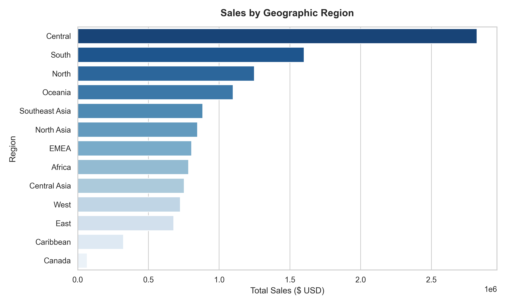
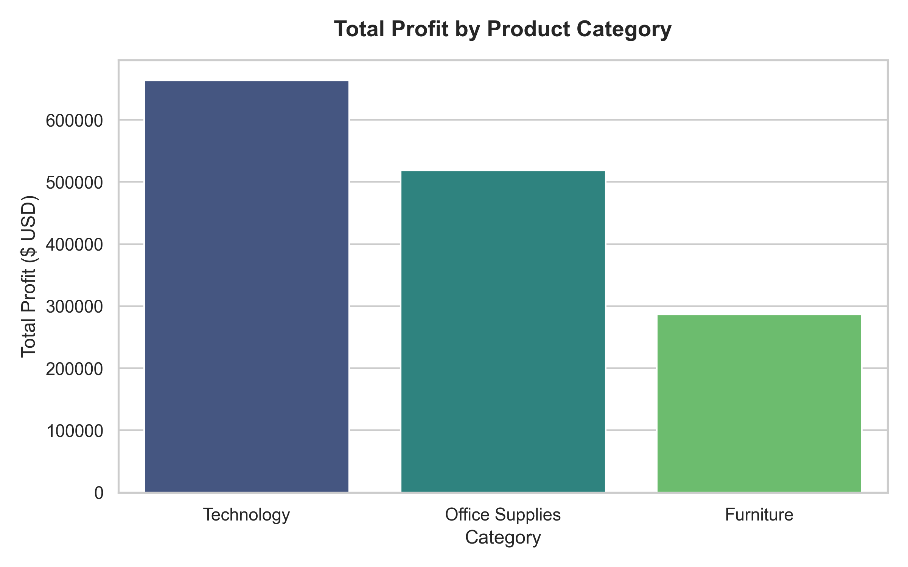
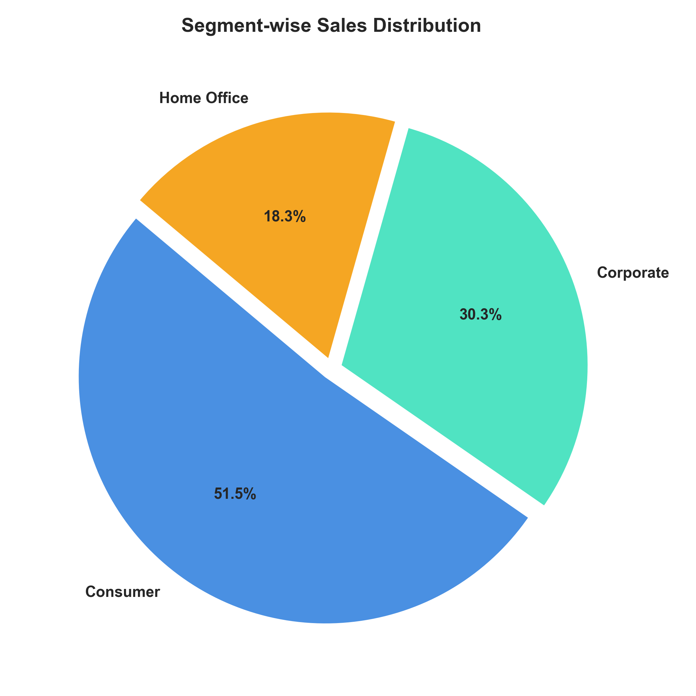
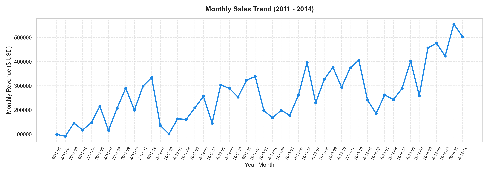

# Level 1 Task 3: Pivot Table & Charts Analysis Report

**Company:** Primeor Solutions  
**Project:** E-Commerce Data Analytics Internship  
**Author:** Rishi Prajapati  
**Workbook:** `Level-1_Data-Cleaning-and-Excel-Analysis/Ecommerce_Analysis_Level1.xlsx` (Sheet: `Pivots & Visuals`)

---

## 1. Visual Analysis & Pivot Summaries

This section provides visual insights and pivot summaries for multi-dimensional business performance across categories, customer segments, geography, and historical timelines.

---

### Chart 1: Sales by Region

- **Central Region** leads global performance with **\$2.82M (22.3%)**, followed by **South (\$1.60M)** and **North (\$1.25M)**.
- Emerging markets in **Oceania (\$1.10M)** and **Southeast Asia (\$883K)** show steady adoption.

---

### Chart 2: Profit by Category

| Category | Total Sales ($) | Total Profit ($) | Profit Margin (%) |
| :--- | :---: | :---: | :---: |
| **Technology** | \$4,742,975.00 | **\$663,337.29** | **13.98%** |
| **Office Supplies** | \$3,786,476.00 | **\$518,219.48** | **13.69%** |
| **Furniture** | \$4,105,771.00 | **\$286,164.92** | **6.97%** |
| **Total** | **\$12,635,222.00** | **\$1,467,721.69** | **11.62%** |

> **Key Insight:** While Furniture brings significant volume (\$4.1M), its profit margin (6.97%) is less than half of Technology (13.98%) due to higher shipping costs and higher discounting rates.

---

### Chart 3: Segment-wise Sales Analysis

| Customer Segment | Total Sales ($) | Total Profit ($) | Sales Contribution (%) |
| :--- | :---: | :---: | :---: |
| **Consumer** | \$6,503,476.00 | \$748,426.44 | **51.5%** |
| **Corporate** | \$3,822,954.00 | \$442,124.49 | **30.3%** |
| **Home Office** | \$2,308,792.00 | \$277,170.76 | **18.3%** |

> **Key Insight:** Individual consumers represent over half of all transactions and revenue, making direct consumer promotions highly impactful.

---

### Chart 4: Monthly Sales Trend (2011 - 2014)

- Clear seasonal cyclicality observed consistently year-over-year:
  - **Q1 Dips:** January and February experience lower purchasing activity following holiday seasons.
  - **Q3 - Q4 Peaks:** Massive surges occur in **September through December**, peaking during holiday shopping cycles, year-end enterprise budget expenditure, and Black Friday sales.
  - Overall multi-year trajectory demonstrates robust top-line year-over-year revenue expansion.
